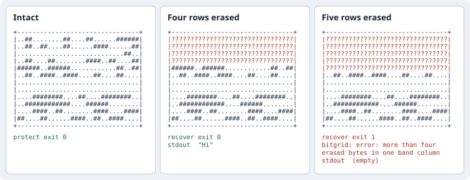

# BitGrid

BitGrid is an experimental C++17 command-line tool for studying erasure recovery in ASCII grids. **BGR1 can reconstruct four marked rows in each 12-row band** when the retained symbols are correct. The example below recovers the payload `Hi` even after masking the rows that hold its signature and length.



| Format | Commands | Behavior |
| --- | --- | --- |
| HABG | `encode`, `decode` | Original square grid with a weighted payload checksum |
| BGR1 | `protect`, `recover` | Column-interleaved Reed–Solomon (12,8) erasure recovery with CRC-32C over the header and payload |

A `??` pair marks an unknown bit and makes its containing byte an erasure. Each band column can lose up to four bytes. Keep borders, row separators, and cell positions intact. The decoder recovers only marked erasures. Unmarked changes may cause a parity or CRC failure. BitGrid's scope is offline experimentation with aligned ASCII. Optical scanning, archive interchange, and production communications have their own formats and tooling. [Format specification](FORMAT.md) · [Design case study](DESIGN.md)

## Build and install

Use CMake 3.16 or newer and a C++17 compiler. The CLI and CTest suites use the C++ standard library and CMake. GitHub Actions runs GCC and Clang on Linux, AppleClang on macOS, and MSVC on Windows for pushes and pull requests.

```sh
cmake -S . -B build -DCMAKE_BUILD_TYPE=Release
cmake --build build --config Release
cmake -E chdir build ctest -C Release --output-on-failure
cmake --install build --config Release --prefix ./build/install
```

With a single-configuration generator the executable is `build/bitgrid`. With Visual Studio it is `build/Release/bitgrid.exe`. The example install places it under `build/install/bin`. Use the appropriate path below if `bitgrid` is outside your `PATH`. For v1.1.0, `bitgrid --version` reports `bitgrid 1.1.0`.

## Usage

```sh
bitgrid encode "Hello world" > message.bgrid
bitgrid decode message.bgrid
bitgrid protect -f "input file.bin" > protected.bgr
bitgrid recover protected.bgr > restored.bin
printf 'first\nsecond' | bitgrid encode - | bitgrid decode -
bitgrid --help
bitgrid --version
```

`encode` and `protect` accept a literal argument, `-f <file>`, or `-` for stdin. `decode` and `recover` accept a file or `-` for stdin. Use `protect -- -f` for the literal bytes `-f` and `recover -- -` to open a file named `-`. Both formats accept up to 65,535 payload bytes. File and stream I/O preserve bytes, including NUL and payload newlines. On Windows, use byte-preserving pipelines or redirection such as those in `cmd.exe`. Literal arguments and paths use the narrow C runtime encoding.

Results go to stdout and diagnostics go to stderr. Exit status is `0` on success and `1` on failure. Recovery writes the validated payload as stored, with no added newline. An output failure can leave partial output.

## Reproduce the experiment

Use Python 3.7 or newer with its standard library after building. The script writes the sample grids and reproduces the SVG above from the executable's output.

```sh
python3 tools/recovery_experiment.py build/bitgrid \
    --output-dir build/demo --demo-svg build/demo/recovery-demo.svg
build/bitgrid recover build/demo/four-rows-erased.bgr > build/demo/restored.bin
cmp build/demo/original.bin build/demo/restored.bin
cmp docs/recovery-demo.svg build/demo/recovery-demo.svg
```

The real decoder restores all **42 placements of one to four consecutive erased rows** in a full band. A model using the same code and parity count with contiguous codewords survives zero of those row losses. All eight placements of five erased rows exceed the budget. The script also compares seven grids byte-for-byte with a separate encoder.

## Development

`main.cpp` handles commands, bounded I/O, and diagnostics. `BitGridCodec.cpp` implements HABG and `BitGridRecovery.cpp` implements BGR1. The two codecs share grid framing and return owned bytes or a typed error through the stateless API in `BitGridCodec.h`. Tests cover known-answer grids, all 4,096 row masks for the BGR1 fixture, mixed column erasures across bands, and maximum-size binary payloads.

Use `-DBUILD_TESTING=OFF` for a CLI-only build. For AddressSanitizer and UndefinedBehaviorSanitizer, configure a separate build with GCC or Clang and `-DBITGRID_ENABLE_SANITIZERS=ON`.

### Optional fuzzing

Install Clang with its libFuzzer and sanitizer runtimes. Each target feeds arbitrary bytes into one parser and checks that accepted payloads survive canonical re-encoding. Keep the writable corpus and failure artifacts in the build directory.

```sh
cmake -S . -B build-fuzz -DCMAKE_CXX_COMPILER=clang++ \
    -DCMAKE_BUILD_TYPE=RelWithDebInfo -DBITGRID_ENABLE_FUZZING=ON
cmake --build build-fuzz --target bitgrid_fuzz_decode bitgrid_fuzz_recover
mkdir -p build-fuzz/corpus/habg build-fuzz/corpus/bgr1
build-fuzz/bitgrid_fuzz_decode -max_total_time=45 -max_len=16384 \
    -artifact_prefix=build-fuzz/corpus/habg/ build-fuzz/corpus/habg tests/fuzz/corpus/habg
build-fuzz/bitgrid_fuzz_recover -max_total_time=45 -max_len=16384 \
    -artifact_prefix=build-fuzz/corpus/bgr1/ build-fuzz/corpus/bgr1 tests/fuzz/corpus/bgr1
```

The targets enable AddressSanitizer and UndefinedBehaviorSanitizer. The sample fuzz commands use a 16 KiB input cap. CTest separately covers maximum-size records. [LLVM libFuzzer documentation](https://llvm.org/docs/LibFuzzer.html)

Apply the repository's `.clang-format` style to C++ changes.

## Author

Haroon Awan · [GitHub](https://github.com/P3rsin)

BitGrid is distributed under the [MIT License](LICENSE).
